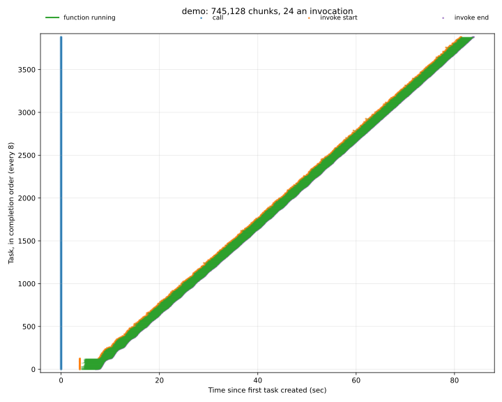
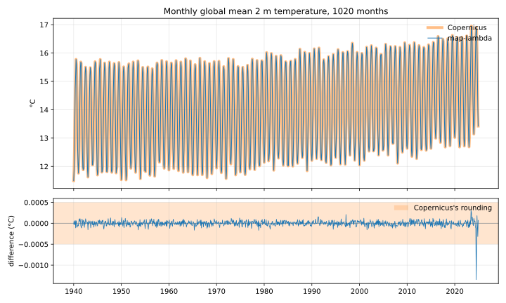

# datafusion-lambda-benchmarks

How fast can we query ERA5 Zarr data using SQL and the [map-lambda](https://github.com/tomwhite/map-lambda) framework?

**The monthly area-weighted global mean temperature over 85 years of hourly
ERA5 (745,128 chunks, 3.1 TB uncompressed) takes ~88s and costs ~$2.17**

The answer matches xarray for a sample month, and the global means Copernicus
publishes from ERA5 to within 0.001°C for all but one of the ~1000 months.

## How it works

A query is planned by [DataFusion](https://datafusion.apache.org/), over Zarr
arrays flattened into tables by [zarr-datafusion](https://github.com/stratoscale-io/zarr-datafusion).

A new physical operator `MapLambdaZarrExec` is used to run partial
aggregates on Lambda workers. The partial aggregate results for each worker
are streamed back to the client which completes the rest of the plan.

This project is set up for running benchmarks, it is not a general purpose SQL engine.

## Dependencies

Both map-lambda and zarr-datafusion are build from pinned versions on GitHub.

zarr-datafusion comes from the `lambda-demo` branch of a fork,
<https://github.com/tomwhite/zarr-datafusion>, pinned to a commit, until its
fixes are merged upstream.

## Running locally

First start `cargo lambda watch` from the `rust/` directory, building first,
because `watch` compiles a function on its first request, which would outlast
the coordinator's invoke timeout:

```shell
cd rust && cargo build && cargo lambda watch
```

Then, in another terminal, run the tests:

```shell
uv run pytest
cd rust && cargo test
```

## Running on AWS

### Deployment

The demo data is in us-east-1, so the workers must be there too (the query
refuses to run otherwise):

```shell
./aws/setup-roles.sh   # once - wait a few seconds for IAM to apply
AWS_REGION=us-east-1 ./aws/deploy.sh
./aws/teardown.sh      # when you're finished
```

The client plans against S3 with credentials from `AWS_*` variables,
so export as follows:

```shell
eval "$(aws configure export-credentials --format env)"; export AWS_REGION=us-east-1
```

### The demo

The demo script computates the monthly area-weighted global mean of `t2m`
over [Earthmover's ERA5](https://registry.opendata.aws/earthmover-era5/),
dataset in Icechunk format. The full dataset goes back to 1940, but the
script accepts a time range to allow you to query part of it.

Start with a few months to check everything is working properly:

```shell
uv run python benchmarks/demo.py --start 2020-01-01 --end 2020-04-01
```

It should complete in a few seconds.

Then run the whole dataset, which costs about $2. The concurrency leaves room
under the account's default limit of 1,000:

```shell
uv run python benchmarks/demo.py --start 1940-01-01 --end 2025-01-01 --concurrency 990
```

In one run, the 1,020 months took 88.2s and cost approximately $2.17:
31,047 invocations of 24 hourly chunks.



### Checking the results

```shell
# one month against xarray, reading about 3 GB from us-east-1
uv run benchmarks/demo_check.py $(ls results/demo-*.json | tail -1) --month 2020-02
# every month against Copernicus's published daily means, charted beside the run
uv run python benchmarks/copernicus_check.py $(ls results/demo-*.json | tail -1)
```

The month matches xarray to 9 decimal places, with identical extremes. Every
month from 1940 to 2022 agrees with Copernicus within about 0.0006°C, which
rounds each day to 0.001°C. Earthmover's copy of 2023 and 2024 differs a
little more, up to 0.0013°C in July 2024. This discrepancy was not explored further.



### The plan

`--explain` prints the query's physical plan, then the fragment that each
fan-out sends to the workers. It doesn't run the query.

```shell
uv run python benchmarks/demo.py --start 1940-01-01 --end 2025-01-01 --concurrency 990 --explain
```

The client runs everything down to the `MapLambdaZarrExec`, which stands in
for the partial aggregate and the scan below it: its 745,128 chunks, those of
the window that pruning kept, go to 31,047 invocations of 24.

```
SortPreservingMergeExec: [month@0 ASC NULLS LAST]
  SortExec: expr=[month@0 ASC NULLS LAST], preserve_partitioning=[true]
    ProjectionExec: expr=[date_trunc(Utf8("month"),era5.valid_time)@0 as month, sum(era5.t2m * cos(radians(era5.latitude)))@1 / sum(cos(radians(era5.latitude)))@2 as mean_t2m, min(era5.t2m)@3 as min_t2m, max(era5.t2m)@4 as max_t2m, count(Int64(1))@5 as n]
      AggregateExec: mode=FinalPartitioned, gby=[date_trunc(Utf8("month"),era5.valid_time)@0 as date_trunc(Utf8("month"),era5.valid_time)], aggr=[sum(era5.t2m * cos(radians(era5.latitude))), sum(cos(radians(era5.latitude))), min(era5.t2m), max(era5.t2m), count(Int64(1))]
        RepartitionExec: partitioning=Hash([date_trunc(Utf8("month"),era5.valid_time)@0], 8), input_partitions=1
          MapLambdaZarrExec: function=fragment, chunks=745128, invocations=31047

fragment:
AggregateExec: mode=Partial, gby=[date_trunc(month, CAST(valid_time@1 AS Timestamp(ns))) as date_trunc(Utf8("month"),era5.valid_time)], aggr=[sum(era5.t2m * cos(radians(era5.latitude))), sum(cos(radians(era5.latitude))), min(era5.t2m), max(era5.t2m), count(Int64(1))]
  ProjectionExec: expr=[cos(radians(CAST(latitude@1 AS Float64))) as __common_expr_1, valid_time@0 as valid_time, t2m@2 as t2m]
    FilterExec: valid_time@0 >= -946771200000000 AND valid_time@0 < 1735689600000000
      ZarrExec: path=s3://earthmover-icechunk-era5/icechunkV2, filters=[valid_time BETWEEN -946771200000000 AND 1735689600000000]
```

Each worker binds the fragment's `ZarrExec` to its own chunks, and returns
one partial row per month it touches.

## AI usage

Code and tests were written with AI assistance from Claude.
